  

   

### Chi sono

> **Costruisco sistemi AI che superano la demo e restano in produzione.**

Junior AI Solutions Engineer in **EnerNext** (Oderzo), base a **Treviso**. Lavoro su estrazione di documenti con LLM, pipeline dati e web app Python e TypeScript per EnerNext ed Espiù: bollette, visure, prezzi dell'energia, un accumulo a batteria.

Seguo il percorso intero, dal PDF che nessuno vuole aprire al servizio che gira su una VM e che qualcun altro usa ogni giorno. La parte che mi interessa è quella che decide se un progetto regge: dove serve un'approvazione umana, cosa succede quando il portale cambia, come ci si accorge che qualcosa si è fermato.

### Stack

<picture>
  <source media="(prefers-color-scheme: dark)" srcset="https://skillicons.dev/icons?i=python%2Cfastapi%2Csklearn%2Cpostgres%2Csupabase%2Cdocker%2Clinux%2Cts%2Creact%2Cnextjs%2Ctailwind%2Cprisma%2Cnodejs%2Cgit&theme=dark&perline=7"/>
  <source media="(prefers-color-scheme: light)" srcset="https://skillicons.dev/icons?i=python%2Cfastapi%2Csklearn%2Cpostgres%2Csupabase%2Cdocker%2Clinux%2Cts%2Creact%2Cnextjs%2Ctailwind%2Cprisma%2Cnodejs%2Cgit&theme=light&perline=7"/>
  
</picture>

  

       

### Lavori selezionati

| Progetto | Stack | Stato |
| :--- | :--- | :--- |
| **BillDex** Bollette luce e gas in PDF che diventano dati verificati: OCR, Claude per strutturare, approvazione umana prima di scrivere sul gestionale. | `Python` `Claude Haiku` `React` `Supabase` |  |
| **EsHub** Gestionale interno di Espiù. Agente LangGraph con RAG sui documenti e tool sul database filtrati per ruolo, più il modulo che consulta il catasto SISTER. | `TypeScript` `LangGraph` `Prisma` `FastAPI` |  |
| **BESS** Controllo continuo di un accumulo industriale via Modbus TCP. Pianificatore su prezzi GME e sole previsto, dashboard React che lo racconta. | `Python` `Modbus TCP` `React` `ECharts` |  |
| **Report Mercati Energetici** Pipeline e webapp che generano le mail periodiche sui mercati luce e gas: prezzi da GME ed EEX, grafici interattivi, deploy automatico. | `Python` `FastAPI` `Playwright` `Docker` |  |
| **Chatbot EnerNext** Assistente guidato per enernext.it come plugin WordPress: macchina a stati, endpoint PHP protetto da nonce, nessun LLM. | `WordPress` `PHP` `jQuery` |  |
| **[IntraMind](https://github.com/zozzy04/local_rag_chatbot)** RAG offline su PDF tecnici: risposte con fonti citate e astensione quando i documenti non bastano. API federata e valutazione Ragas. | `LangChain` `Ollama` `Qdrant` `FastAPI` |  |
| **[Sistema Documentale](https://github.com/zozzy04/Sistema-Documentale-Aziendale-in-Python)** Archivio con ricerca full-text su Solr e domande in linguaggio naturale via RAG su LLM locale. OCR per i PDF scansionati. | `FastAPI` `Solr` `Supabase` `React` |  |

<a href="https://github.com/zozzy04/local_rag_chatbot">
  <picture>
    <source media="(prefers-color-scheme: dark)" srcset="https://github-readme-stats.vercel.app/api/pin/?username=zozzy04&repo=local_rag_chatbot&show_owner=false&hide_border=true&border_radius=14&bg_color=0D1117&title_color=22D3EE&text_color=9BA7B8&icon_color=818CF8"/>
    <source media="(prefers-color-scheme: light)" srcset="https://github-readme-stats.vercel.app/api/pin/?username=zozzy04&repo=local_rag_chatbot&show_owner=false&hide_border=true&border_radius=14&bg_color=FFFFFF&title_color=0891B2&text_color=334155&icon_color=6366F1"/>
    
  </picture>
</a>
<a href="https://github.com/zozzy04/Sistema-Documentale-Aziendale-in-Python">
  <picture>
    <source media="(prefers-color-scheme: dark)" srcset="https://github-readme-stats.vercel.app/api/pin/?username=zozzy04&repo=Sistema-Documentale-Aziendale-in-Python&show_owner=false&hide_border=true&border_radius=14&bg_color=0D1117&title_color=22D3EE&text_color=9BA7B8&icon_color=818CF8"/>
    <source media="(prefers-color-scheme: light)" srcset="https://github-readme-stats.vercel.app/api/pin/?username=zozzy04&repo=Sistema-Documentale-Aziendale-in-Python&show_owner=false&hide_border=true&border_radius=14&bg_color=FFFFFF&title_color=0891B2&text_color=334155&icon_color=6366F1"/>
    
  </picture>
</a>

> Il resto vive in repository private — per questo il grafico qui sotto è
> più vuoto di quanto dica il lavoro vero. Scrivimi se vuoi vedere qualcosa
> nel dettaglio.

### Come lavoro

<table>
<tr>
<td width="33%" valign="top">

**01 · Un'approvazione umana dove serve**

Niente finisce sul gestionale, sul bus Modbus o in una mail al cliente senza un passaggio che una persona può vedere e fermare. Il modello propone, la responsabilità resta a chi approva.

</td>
<td width="33%" valign="top">

**02 · Parto dai dati veri**

Bollette scansionate, portali senza API dietro un captcha, prezzi che cambiano formato, letture con buchi. La pipeline nasce sui file di produzione, non su un campione pulito.

</td>
<td width="33%" valign="top">

**03 · Consegno cose che si mantengono**

Test che girano senza rete, CI su ogni pull request, deploy automatico, un README che dice il perché delle scelte. Chi arriva dopo deve poter intervenire senza chiedermelo.

</td>
</tr>
</table>

### In numeri

<picture>
  <source media="(prefers-color-scheme: dark)" srcset="https://github-readme-stats.vercel.app/api?username=zozzy04&show_icons=true&hide_border=true&border_radius=14&card_width=500&rank_icon=github&custom_title=GitHub%20·%20Riccardo%20Zozzolotto&bg_color=0D1117&title_color=22D3EE&text_color=9BA7B8&icon_color=818CF8"/>
  <source media="(prefers-color-scheme: light)" srcset="https://github-readme-stats.vercel.app/api?username=zozzy04&show_icons=true&hide_border=true&border_radius=14&card_width=500&rank_icon=github&custom_title=GitHub%20·%20Riccardo%20Zozzolotto&bg_color=FFFFFF&title_color=0891B2&text_color=334155&icon_color=6366F1"/>
  
</picture>

<picture>
  <source media="(prefers-color-scheme: dark)" srcset="https://streak-stats.demolab.com?user=zozzy04&locale=it&hide_border=true&border_radius=14&date_format=j%20M%5B%20Y%5D&background=0D1117&stroke=1F2937&ring=22D3EE&fire=F472B6&currStreakNum=F1F5F9&currStreakLabel=22D3EE&sideNums=CBD5E1&sideLabels=818CF8&dates=64748B"/>
  <source media="(prefers-color-scheme: light)" srcset="https://streak-stats.demolab.com?user=zozzy04&locale=it&hide_border=true&border_radius=14&date_format=j%20M%5B%20Y%5D&background=FFFFFF&stroke=E2E8F0&ring=0891B2&fire=DB2777&currStreakNum=0F172A&currStreakLabel=0891B2&sideNums=334155&sideLabels=6366F1&dates=94A3B8"/>
  
</picture>

<picture>
  <source media="(prefers-color-scheme: dark)" srcset="https://github-readme-stats.vercel.app/api/top-langs/?username=zozzy04&layout=compact&langs_count=6&hide=html%2Ccss%2Cmako%2Cplpgsql%2Cshell&hide_border=true&border_radius=14&locale=it&card_width=480&bg_color=0D1117&title_color=22D3EE&text_color=9BA7B8"/>
  <source media="(prefers-color-scheme: light)" srcset="https://github-readme-stats.vercel.app/api/top-langs/?username=zozzy04&layout=compact&langs_count=6&hide=html%2Ccss%2Cmako%2Cplpgsql%2Cshell&hide_border=true&border_radius=14&locale=it&card_width=480&bg_color=FFFFFF&title_color=0891B2&text_color=334155"/>
  
</picture>

<picture>
  <source media="(prefers-color-scheme: dark)" srcset="https://github-profile-summary-cards.vercel.app/api/cards/profile-details?username=zozzy04&theme=github_dark"/>
  <source media="(prefers-color-scheme: light)" srcset="https://github-profile-summary-cards.vercel.app/api/cards/profile-details?username=zozzy04&theme=github"/>
  
</picture>

  

<picture>
  <source media="(prefers-color-scheme: dark)" srcset="https://raw.githubusercontent.com/zozzy04/zozzy04/output/github-contribution-grid-snake-dark.svg"/>
  <source media="(prefers-color-scheme: light)" srcset="https://raw.githubusercontent.com/zozzy04/zozzy04/output/github-contribution-grid-snake.svg"/>
  
</picture>

### Percorso

| | |
| :--- | :--- |
| **ago 2026 — oggi** | Junior AI Solutions Engineer · EnerNext, Oderzo |
| **mag — ago 2026** | IT Assistant · EnerNext, Oderzo |
| **ott 2025 — feb 2026** | Tirocinio · EnerNext, Oderzo |
| **2024 — 2026** | ITS AI Developer &amp; Data Analyst, Mestre — **110** |

### Lavoriamo insieme

**[riccardozozzolotto.it](https://riccardozozzolotto.it)** · **[LinkedIn](https://www.linkedin.com/in/riccardo-zozzolotto-53aa732b1/)** · **[rzozzolotto@gmail.com](mailto:rzozzolotto@gmail.com)**

 

Treviso · <em>Il modello propone, la responsabilità resta a chi approva.</em>

